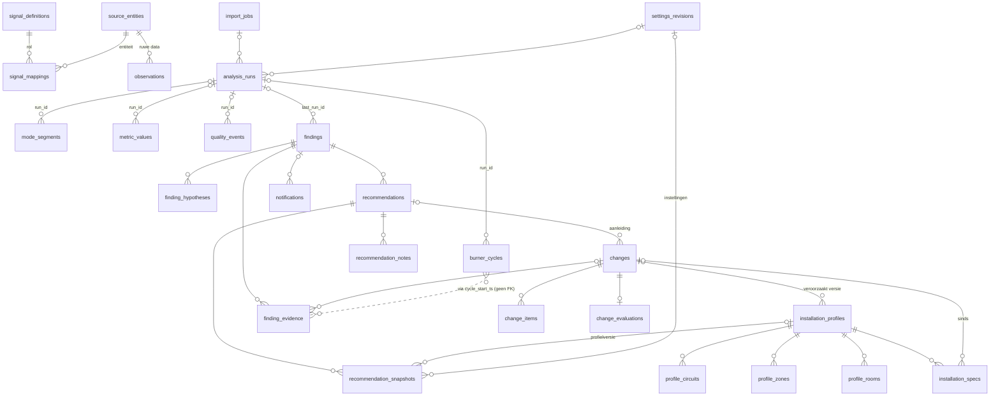

# ADR-001 — Domeinmodel en databaseschema

- **Status:** voorgesteld (ter review in PR voor #7)
- **Datum:** 4 oktober 2026
- **Requirements:** FR-01–03, FR-06, FR-10, FR-29, FR-41 (en FR-21–28, FR-30/32, FR-39 voor de structuur)
- **Bronnen:** technisch plan §2.1 en §3.2–3.8, ontwerp v3, [ontwerpaanvullingen](../design/aanvullingen.md) (§1.5 instellingen, §2 onboarding, §3a perioden, §4 import), [ADR-002](002-pipeline.md) (pipeline-types, sleutels, venster/watermark)
- **Code:** `backend/src/cvidee/store/` (modellen, enums, engine, repositories), `backend/migrations/` (Alembic, revisie `0001`)

## 1. Context

Alle backend-lanes (ingest, analyse/runner, bevindingen/wijzigingen, API) hebben één gedeeld schema nodig. Dit ADR legt tabellen, sleutels, versiebeheer, tijdconventie, herkomst, de representatie van *onbekend*, retentie en de repository-grens vast. Het schema is als SQLAlchemy 2-modellen (getypeerd, `Mapped[...]`) en als eerste Alembic-migratie opgeleverd; een test bewaakt dat model en migratie gelijk zijn.

## 2. Besluiten in het kort

| # | Besluit |
|---|---|
| B1 | **Tijd** is overal UTC als `INTEGER` milliseconden sinds epoch, kolomnaam eindigt op `_ts`. Omrekenen naar `Europe/Amsterdam` alleen voor weergave. |
| B2 | **Ruwe data hangt aan de HA-entiteit**, niet aan de signaalrol: `observations.source_entity_id → source_entities`. De koppeling rol → entiteit (`signal_mappings`) wordt bij analyse toegepast. Een herkoppeling maakt ruwe data dus nooit ongeldig en herberekening volstaat. (Afwijking van plan §3.2, dat `signal_id` noemt.) |
| B3 | **Versiebeheer in datatijd** met `valid_from_ts`/`valid_to_ts` (`valid_to_ts IS NULL` = huidig) voor `signal_mappings` en `installation_profiles`. Instellingen zijn **append-only revisies** in wandkloktijd. |
| B4 | **Deterministische sleutels** voor afgeleide data, gelijk aan ADR-002: cyclus = `start_ts`, modussegment = `start_ts`, kwaliteitsgebeurtenis = `(kind, signal, start_ts)`, kengetal = `(name, mode, window_kind, window_start_ts, cycle_start_ts)`. Modussegmenten en kwaliteitsgebeurtenissen zijn op hele UTC-uren gesplitst. De runner doet **replace-from**: verwijder alle afgeleide rijen met sleutel `≥ emit_from` en voeg de uitvoer in, in één transactie. |
| B5 | **Herkomst** via `ValueKind {measured, reported, derived, estimated}` (de `IntEnum` uit `cvidee.analysis.types`, geordend naar sterkte; opgeslagen als naam in kleine letters) op koppelingen, signaaldefinities en kengetallen. |
| B6 | **Onbekend is expliciet**: installatiespecificaties hebben `status ∈ {known, unknown, not_applicable}` met een CHECK dat er een waarde is **dan en slechts dan als** `status = 'known'`. Feiten die onbekend kunnen zijn worden `TriState {yes, no, unknown}`. Kengetallen hebben `status ∈ {ok, insufficient_data}` met dezelfde CHECK. |
| B7 | **Enums** worden als TEXT opgeslagen (de `value`, niet de naam). Gesloten verzamelingen krijgen een CHECK-constraint; open verzamelingen die zullen groeien (regel-id's, spec-sleutels, kengetalnamen, instellingssleutels, categorieën) zijn vrije TEXT, gevalideerd in code — toevoegen vraagt dan geen migratie. Enums van het analysecontract (`Mode`, `ModeCertainty`, `EndReason`, `QualityEventKind`, `MetricWindowKind`, `MetricName`, `ObservationKind`, `ConnectionSource`, `ValueKind`) komen **uit `cvidee.analysis.types`** (re-export in `cvidee.store.enums`); `store` importeert `analysis.types`, nooit andersom. Een nieuwe waarde daarin vraagt een migratie (CHECK) — dat gaat toch al via een ADR-PR. |
| B8 | **Max. sensorleeftijd en `heartbeat_expected`** ("verwacht regelmatige updates") staan alleen in `signal_mappings` (één bron, besluit coördinator n.a.v. aanvullingen §7 vraag 3). De standaardwaarden per rol staan in `signal_definitions`. |
| B9 | **Repository-grens**: tijdreeksen (ruwe + afgeleide data) via opslag-neutrale dataclasses (`store/records.py`), configuratie/documenten via ORM-entiteiten. Repositories committen nooit. |
| B10 | **SQLite** met WAL, `busy_timeout=5000`, `foreign_keys=ON`, `synchronous=NORMAL` op elke verbinding; synchrone SQLAlchemy-engine (FastAPI roept via threadpool). Pad uit `CVIDEE_DB_PATH` (`cvidee.config`, add-on: `/data/cvidee.sqlite`), of een volledige URL via `CVIDEE_DB_URL`. |

## 3. Conventies

- **Namen:** tabellen meervoud snake_case, Engelse identifiers volgens de woordenlijst in `AGENTS.md`. Constraint-namen volgen een vaste naming convention (`pk_`, `fk_`, `uq_`, `ix_`, `ck_<tabel>_<naam>`), nodig voor SQLite-batchmigraties en voor een tweede backend.
- **Tijd (B1):** `BIGINT` ms epoch UTC. Intervallen zijn halfopen `[start_ts, end_ts)`. Datum-/DST-logica (dag- en uurvensters, "vandaag") rekent in `Europe/Amsterdam` en zet grenzen om naar UTC-ms; een dag kan dus 23 of 25 uur lang zijn (25 okt 2026).
- **JSON** (`JSON`, in PostgreSQL later `JSONB`) alleen voor waarden die als geheel gelezen worden en niet in een WHERE staan: onderbouwing, parameters, vergelijkbaarheidschecks, payloads. De vorm wordt in code (pydantic) bewaakt door het eigenaar-ticket.
- **NULL** betekent alleen nog: "nog niet gezet / niet van toepassing" bij configuratie (bv. `expected_resolution_ms`), "nog niet gebeurd" bij tijdstempels (`finished_at_ts`), "open einde" bij `valid_to_ts`/`end_ts`, of een structurele afwezigheid die in de kolomdocumentatie staat. **Nooit** "onbekende meetwaarde of specificatie" — daarvoor is er een status (B6).
- **Lege scope:** `scope_key` is `''` (nooit NULL) voor rollen/kengetallen zonder ruimte/zone/circuit, zodat unieke sleutels in SQLite werken (NULL's zijn daar onderling verschillend). Vorm: `room:<key>`, `zone:<key>`, `circuit:<key>`; `<key>` is de stabiele sleutel uit het profiel.
- **Menselijke id's** (`B-014`, `W-07`) worden bij invoegen door de repository toegekend (volgnummer, nooit hergebruikt) en zijn uniek.

## 4. ER-overzicht

Losse tabellen zonder FK: `connection_events`, `special_periods`, `notification_policy`.

## 5. Tabellen

Notatie: **PK**, *UQ* = unieke sleutel, IX = index, FK = foreign key. Alle `*_ts` zijn `BIGINT` ms UTC. Enum-kolommen zijn TEXT met CHECK tenzij "open" vermeld.

### 5.1 Signalen en ruwe data

**`signal_definitions`** — catalogus van signaalrollen (requirements §2). Bron van waarheid is de catalogus in code (#18); bij opstarten gesynchroniseerd zodat koppelingen een FK hebben.

| Kolom | Type | Opmerking |
|---|---|---|
| **role** | TEXT(64) | waarde van `analysis.types.Role`: `flame`, `operating_mode`, `heat_demand`, `flow_setpoint`, `flow_temperature`, … |
| value_type | TEXT | `numeric \| boolean \| enum \| text` |
| unit | TEXT? | canonieke eenheid |
| scope_type | TEXT | `ScopeKind`-waarde uit `analysis.types` (`boiler`, `outdoor`, `room`, `zone`, `circuit`, `manifold`) |
| default_kind | ValueKind | |
| cumulative | BOOL | tellers (gas): resets ⇒ nieuw segment |
| plausible_min / plausible_max | REAL? | plausibiliteitsgrenzen (FR-07) |
| default_max_age_ms | INT | standaard uit aanvullingen §1.5 (ketel 30 s, kamer 10 min, …) |
| default_heartbeat_expected | BOOL | |
| required_for | JSON | analyse-id's (FR-04) |
| catalogue_version | TEXT | |

**`source_entities`** — HA-entiteiten waarvan we data hebben. **id**; *UQ* `entity_id`; `friendly_name`, `unit`, `device_class`, `first_seen_ts`, `last_seen_ts`.

**`signal_mappings`** (FR-01, versiebeheerd) — **id**; FK `role → signal_definitions`, FK `source_entity_id → source_entities`; `scope_key` (`''` = standaardscope van de rol: ketel/buiten; anders `<kind>:<key>`, gelijk aan het achtervoegsel van `str(SignalRef)`); `unit`, `location`, `meaning`; `kind` (ValueKind); `heartbeat_expected` BOOL; `max_age_ms` INT (verplicht, standaard uit de definitie; heeft alleen effect als `heartbeat_expected`, zie ADR-003); `expected_resolution_ms` INT? (gewenste resolutie, NULL = niet ingesteld); `value_map` JSON? (ruwe HA-state → canonieke waarde, bv. statuscodes); `valid_from_ts`, `valid_to_ts?`, `created_at_ts`.
*UQ (partieel)* `(role, scope_key) WHERE valid_to_ts IS NULL` — hooguit één huidige koppeling per rol. IX `source_entity_id`.
Ontkoppelen = huidige rij afsluiten (`valid_to_ts`). Wijzigen = afsluiten + nieuwe rij met dezelfde `valid_from_ts` als het sluitmoment (geen overlap; repository-invariant).

**`observations`** (FR-06, FR-08) — **id** (rowid); FK `source_entity_id`; `ts`; `state` TEXT (ruwe HA-state, ook `unavailable`/`unknown` — dat zijn expliciet onbekende waarden); `value_num` REAL? (geparsed, NULL als niet numeriek); `kind` ∈ {`change`, `confirm`, `poll`} (`ObservationKind`); `last_reported_ts?` (HA `last_reported`, bewijstijd voor ADR-002 §7); `origin` ∈ {`live`, `import`}; `received_at_ts`. Bij lezen maakt de store er `analysis.types.Observation` van door de koppeling op `ts` toe te passen (`state` → `value`, `unavailable`/`unknown` → `None`).
*UQ* `(source_entity_id, ts, state)` = ontdubbelsleutel én range-index. IX `ts` (retentie).
`change` = overgang (`last_changed`), `confirm` = zelfde waarde opnieuw gemeld (heartbeat/`last_reported`), `poll` = peiling via `get_states` na (her)verbinden: nooit een overgang (geen kunstmatige branderstart, scenario 5).

**`connection_events`** — **id**; `source` ∈ {`ws`, `can_gateway`} (`ConnectionSource`); `ts`; `up` BOOL; `detail?`. *UQ* `(source, ts, up)` (idempotent). Spiegelt `analysis.types.ConnectionEvent`. De MQTT-verbinding (uitvoerkant) hoort hier niet; die status leeft in `ha_export` (#40).

### 5.2 Installatie en perioden

**`installation_profiles`** (FR-02/03, versiebeheerd) — **id**; `valid_from_ts` (IX), `valid_to_ts?`, `created_at_ts`, FK `change_id? → changes` (de wijziging die deze versie veroorzaakte, bv. W-07), `note`.
Elke bewerking maakt een **nieuwe versie met een volledige kopie** van de kinderen (copy-on-write). Analyses en snapshots verwijzen zo naar een onveranderlijke `profile_id`. "Hooguit één huidige versie" is een repository-invariant (een partiële unieke index op een NULL-kolom werkt niet in SQLite).

Kinderen (FK `profile_id` met `ON DELETE CASCADE`, *UQ* `(profile_id, key)`; `key` is stabiel over versies heen):

| Tabel | Kolommen |
|---|---|
| `profile_circuits` | `key`, `name`, `kind` ∈ {`direct`, `mixing_manifold`}, `emitter` ∈ {`radiator`, `underfloor`, `other`, `unknown`} |
| `profile_zones` | `key`, `name`, `circuit_key?` |
| `profile_rooms` | `key`, `name`, `circuit_key?`, `zone_key?`, `has_thermostat`, `is_demand_source` (deze thermostaat bepaalt de warmtevraag) |

Sensor per ruimte loopt via `signal_mappings` (rol `room_temperature`, scope `room:<key>`), niet via het profiel.

**`installation_specs`** — **id**; FK `profile_id`; `scope_key` (`''` = ketel/algemeen, of `circuit:boven`); `key` (open: `boiler_model`, `controller_model`, `max_flow_temperature`, `max_ch_power`, `min_power`, `pump_setting`, `modulation_kw_conversion`, `loop_count`, …); `status` ∈ {`known`, `unknown`, `not_applicable`}; `value_num?`, `value_text?`, `unit?`, `note?`; FK `change_id?` ("sinds 21 sep (W-07)").
*UQ* `(profile_id, scope_key, key)`. CHECK `ck_installation_specs_value_iff_known`: `(status = 'known') = (value_num IS NOT NULL OR value_text IS NOT NULL)`.
Zo is "Minimumvermogen: Onbekend" een rij met `status='unknown'` en "Modulatie → kW: niet omgerekend" een rij `modulation_kw_conversion` met `status='unknown'` (FR-03: nooit omrekenen zonder `known`). Ontbrekende rij = nog nooit ingevuld; de API toont dat ook als *onbekend*.

**`special_periods`** (FR-10, aanvullingen §3a) — **id**; `kind` ∈ {`commissioning` (opstookprotocol), `maintenance`, `venting` (ontluchten), `test`, `vacation`, `special_use`}; `start_ts`; `end_ts?` (NULL = "loopt nog"); `description` (max 140); `exclude_from_baseline`, `exclude_from_comparisons`, `exclude_from_ch_conclusions` (BOOL, standaard aan — de drie toggles "Niet meetellen voor"); `created_at_ts`, `updated_at_ts`.
IX `(start_ts, end_ts)`. CHECK `end_ts IS NULL OR end_ts > start_ts`. **Bewerkbaar** via `PUT /api/periods/{id}` (aanvullingen §7 vraag 8): id blijft gelijk, `updated_at_ts` wordt bijgewerkt; elke wijziging (ook verwijderen) zet een herberekening voor `[min(oud, nieuw) start, max(oud, nieuw) eind)` in de wachtrij. Overlap tussen perioden is toegestaan. Geen soft delete: evaluaties bewaren de uitgesloten perioden zelf in JSON.

### 5.3 Afgeleide data (runner, ADR-002)

De vier afgeleide tabellen spiegelen de resultaattypes in `cvidee.analysis.types` en worden alleen door de runner (#27) geschreven. Per run, in **één transactie** (`DerivedDataRepository.replace_from`): verwijder in alle vier de tabellen de rijen met sleutel `≥ emit_from` (cycli/segmenten/gebeurtenissen op `start_ts`, kengetallen op `window_start_ts`), voeg `PipelineResult.*` in en sla de run op. Elke tabel heeft daarvoor een index die met de tijdkolom begint. `final` (definitief) komt rechtstreeks uit de types; voorlopige rijen worden door een latere run vervangen. `run_id → analysis_runs` met `ON DELETE SET NULL`.

**`mode_segments`** — **start_ts**; `end_ts` (CHECK `> start_ts`); `mode` ∈ {`ch`, `dhw`, `standby`, `afterrun`, `fault_blocking`, `unknown`} (`Mode`); `certainty` ∈ {`direct`, `inferred`, `none`} (`ModeCertainty`; CHECK: `mode = 'unknown'` dan en slechts dan als `certainty = 'none'`); `sources` JSON (`[str(SignalRef)]`); `final`; `run_id`. Op hele UTC-uren gesplitst; de API voegt aangrenzende gelijke stukken samen voor weergave.

**`burner_cycles`** (FR-12) — **start_ts**; `end_ts?` (NULL = brandt nog op de horizon: open en voorlopig); `duration_ms` (ondergrens als niet `complete`, "≥ 4:00"); `complete`; `start_observed` (FR-08: `false` telt nooit als start); `mode`; `end_reason?` ∈ {`stop_during_demand`, `demand_ended`, `dhw_ended`, `data_gap`, `undetermined`} (`EndReason`); `phases` JSON (`[{phase, start, end}]`, FR-15); aggregaten `flow_setpoint_c?`, `flow_max_c?`, `flow_mean_c?`, `return_mean_c?`, `modulation_mean_pct?`, `modulation_min_pct?` (NULL = signaal onbekend/niet gekoppeld, zoals in het type); `heat_demand_during`, `heat_demand_after_stop` (TriState — het type gebruikt `bool | None`, de store maakt *onbekend* expliciet); `signal_coverage`; `pause_before_ms?`; `final`; `run_id`. IX `end_ts`.
CHECK's: open cyclus ⇒ geen eindreden, niet `complete`, niet `final`; gesloten cyclus ⇒ `end_ts > start_ts` en een eindreden; `duration_ms ≥ 0`. "Kort" wordt **niet** opgeslagen: het hangt af van een drempelinstelling en wordt bij samenvatten berekend (complete CV-cyclus, `stop_during_demand`, duur < drempel). Tapwater-/uitsluiting volgt uit `mode` en de bijzondere perioden.

**`metric_values`** (FR-11, FR-13) — **(name, mode, window_kind, window_start_ts, cycle_start_ts)**: `name` (`MetricName`-waarde, open TEXT); `mode` TEXT (`''` = alle modi, anders een `Mode`-waarde; CHECK); `window_kind` ∈ {`hour`, `day`, `cycle`, `period`}; `window_start_ts`; `cycle_start_ts` (`-1` = geen cyclusvenster; CHECK: `≥ 0` dan en slechts dan als `window_kind = 'cycle'`); `window_end_ts`; `status` ∈ {`ok`, `insufficient_data`}; `value_num?` (CHECK: aanwezig dan en slechts dan als `ok`); `unit`; `time_basis_seconds` (waargenomen tijd); `coverage` (0..1, CHECK); `provenance_kind` (ValueKind); `final`; `run_id`. IX `window_start_ts`.
Sentinels (`''`, `-1`) i.p.v. NULL omdat NULL's in een SQLite-sleutel onderling verschillen. De runner materialiseert alleen uur-buckets en per-cyclus-kengetallen; dag/periode worden op aanvraag uit opgeslagen cycli berekend (ADR-002 §3.5) en mogen hier met dezelfde replace-from-regel gecachet worden.

**`quality_events`** (FR-07/08/11) — **id**; `kind` (`QualityEventKind`: `data_gap`, `stale`, `invalid`, `implausible`, `unavailable`, `connection_lost`, `counter_reset`, `duplicate`, `misaligned`); `signal` TEXT (`str(SignalRef)`, bv. `flow_temperature@boiler`; `''` = alle signalen); `start_ts`; `end_ts?` (NULL = loopt nog op de horizon); `detail` TEXT; `final` (CHECK: lopend ⇒ niet definitief); `run_id`.
*UQ* `(kind, signal, start_ts)` = deterministische sleutel; op hele UTC-uren gesplitst. IX `start_ts`. Gebeurtenissen die ingest zelf vaststelt (aantal ontdubbelde metingen bij import) staan in `import_jobs`/`analysis_runs.stats`, niet hier, zodat deze tabel volledig door de pipeline wordt bepaald.

**`analysis_runs`** — **id**; `trigger` ∈ {`live`, `import`, `recompute`}; `status` ∈ {`queued`, `running`, `succeeded`, `failed`, `superseded`}; `reason?` (`settings_changed`, `period_edited`, `mapping_changed`, `late_data`, …); `emit_from_ts`; `context_start_ts?`, `horizon_ts?` (= `AnalysisWindow.end`); `watermark_ts?` (= `next_watermark`, gezet bij succes); `requested_at_ts`, `started_at_ts?`, `finished_at_ts?`; `rule_versions` JSON (`{rule_id: semver}`); `config_hash`; FK `settings_revision_id?`; FK `import_job_id?`; `stats`, `errors` JSON. IX `(status, trigger)`.
Een herberekeningsverzoek (configuratiewijziging met `valid_from`, bewerkte periode, late waarneming — ADR-002 §4.6) is een rij met `status='queued'` en alleen `emit_from_ts`. **Effectief watermark** = `min(watermark_ts van de laatste geslaagde run, emit_from_ts van alle wachtende verzoeken)`; een nieuw verzoek kan een wachtend verzoek `superseded` maken (aanvullingen §1.6).

**`import_jobs`** (FR-06, aanvullingen §4) — **id**; `status` ∈ {`pending`, `fetching`, `analysing`, `done`, `interrupted`, `failed`, `cancelled`}; `from_ts`, `to_ts`; `roles` JSON? (NULL = alle gekoppelde); `cursor_ts?` (hervatpunt); `blocks_done`, `blocks_total`; `observations_imported`, `duplicates_skipped`; `earliest_available_ts?`; `cycles_found?`; `coverage?`; `per_signal` JSON (`[{role, observations, first_ts}]`); `errors` JSON; `created_at_ts`, `started_at_ts?`, `finished_at_ts?`. "Maximaal één import tegelijk" is een service-invariant (#19).

### 5.4 Bevindingen en aanbevelingen (§3.6)

**`findings`** — **id**; *UQ* `human_id` (`B-014`); `rule_id`, `rule_version`, `rule_params` JSON; `scope_key`; `category` (open: `cycles`, `temperature`, `data_quality`, `hydraulic`, `operating_context`, `effect_measurement`); `title`; `severity` ∈ {`high`, `medium`, `low`, `info`}; `certainty` ∈ {`insufficient_evidence`, `preliminary`, `moderate`, `reasonable`, `high`, `high_measured`}; `relevance` JSON (lijst); **`observation`**, **`interpretation`** (TEXT, FR-21 — het advies staat in `recommendations`); `no_advice_text?` (waarom geen advies); `period_start_ts`, `period_end_ts`, `period_note?`; `signals` JSON (rollen); `support` JSON — onderbouwing FR-22: `{coverage, unknown_ms, relevant_cycles, total_cycles, repetition_days, repetition_window_days, missing_signals[]}` (vorm definitief in #10/#34); `priority_score` + `priority_explanation` JSON; `lifecycle` ∈ {`active`, `resolved`}; `resolution_reason?` ∈ {`recovered`, `settings_changed`, `rule_changed`, `superseded`} (aanvullingen §7 vraag 6: "Instelling gewijzigd" ≠ "Hersteld"); `first_seen_ts`, `last_seen_ts`, `resolved_at_ts?`; FK `last_run_id?`.
*UQ (partieel)* `(rule_id, scope_key) WHERE lifecycle = 'active'` = dedupe (één actieve bevinding per probleem, FR-39). IX `(lifecycle, last_seen_ts)`. Terugkeer na herstel = nieuwe bevinding met nieuw `human_id`.

**`finding_hypotheses`** (FR-23) — **id**; FK `finding_id` (cascade); `ordinal`, `name`, `evidence_for`, `evidence_against`, `distinguishing_measurement`.

**`finding_evidence`** (FR-37) — **id**; FK `finding_id` (cascade); `kind` ∈ {`cycle`, `signal`, `time_range`, `metric`, `quality_event`, `change`, `bundled_candidate`}; `cycle_start_ts?` (**geen FK**: cycli worden per venster vervangen maar houden hun deterministische sleutel); `role?`, `scope_key?`; `start_ts?`, `end_ts?`; `metric?`, `value_num?`; FK `change_id?`; `rule_id?`, `rule_version?`, `summary?` (bij `bundled_candidate`: de oorspronkelijke kandidaat met regelversie, FR-26 "Samengevoegd tot één punt"). IX `(finding_id, kind)`.

**`recommendations`** (FR-24/25/27/28) — **id**; FK `finding_id` (IX); `rule_id`, `rule_version`; `is_additional_measurement` (FR-28: aanvullende meting i.p.v. diagnose); `action`, `reason`, `expected_effect`, `comfort_impact?`; `magnitude` + `magnitude_substantiated` (expliciet "niet te onderbouwen" i.p.v. een verzonnen getal); `conditions?`, `evaluation?`, `success_criterion?`, `rollback_criterion?`, `follow_up?` ("Daarna"); machine-toetsbare `success_spec?`/`rollback_spec?` JSON (per advies eigen grens mogelijk, aanvullingen §7 vraag 9); `status` ∈ {`open`, `accepted`, `postponed`, `done`, `rejected`, `rollback_triggered`} (IX); `postponed_until_ts?`; `outcome` ∈ {`pending`, `succeeded`, `unfavourable`, `undecided`}; `created_at_ts`, `status_changed_at_ts`.

**`recommendation_notes`** — **id**; FK `recommendation_id` (cascade, IX); `created_at_ts`; `text`.

**`recommendation_snapshots`** (FR-41, onveranderlijk) — **id**; FK `recommendation_id`, FK `finding_id`; `taken_at_ts`; `trigger` ∈ {`created`, `status_changed`, `content_updated`}; `status`, `outcome` (zoals toen); `measurement_start_ts`, `measurement_end_ts`; `rule_id`, `rule_version`, `rule_params` JSON; FK `profile_id?` (profielversie); FK `settings_revision_id?`; `config_hash`; `settings` JSON (relevante drempels/specs zoals getoond: "Kortecyclusgrens 3 min · max aanvoer 60 °C"); `content` JSON (volledige bevinding + advies zoals toen: het "waarom"); `note?`. IX `(recommendation_id, taken_at_ts)`.
"Sindsdien:" wordt bij lezen berekend door `rule_version`/`rule_params` met de huidige regel te vergelijken (#37).

### 5.5 Wijzigingen en effectmeting (§3.7)

**`changes`** (FR-29) — **id**; *UQ* `human_id` (`W-07`); `changed_at_ts` (IX; tijdstip in de installatie, voor markers in grafieken, aanvullingen §6); `recorded_at_ts`; `performed_by` ∈ {`user`, `installer`, `other`}; `reason?`; FK `recommendation_id?`.

**`change_items`** — **id**; FK `change_id` (cascade); `ordinal` (*UQ* met `change_id`); `parameter_key` (open; uit de lijst of `custom`), `parameter_label`; `old_value`, `new_value` (weergavetekst), `old_value_num?`, `new_value_num?`, `unit?`; `spec_key?` (als dit een installatiespec bijwerkt, ontstaat een nieuwe profielversie met `change_id`).
Eén wijziging met meerdere items (W-06: pompstand + max. aanvoer) is precies het geval dat FR-32 als "niet toe te schrijven" moet herkennen; overlap tussen verschillende wijzigingen wordt op `changed_at_ts` bepaald.

**`change_evaluations`** (FR-30/32) — **id**; FK `change_id` (*UQ*, cascade): één huidige evaluatie per wijziging, in place herberekend; `computed_at_ts`; `reference_start_ts`/`_end_ts`, `observation_start_ts`/`_end_ts`; `verdict` ∈ {`pending`, `improved`, `worsened`, `trade_off`, `not_attributable`, `insufficient_evidence`}; `summary?`; `rollback_triggered`; `comparability` JSON (`[{check, reference, observation, outcome: ok|limited|failed|excluded}]`); `metrics` JSON (`[{metric, note, before, after, unit, effect, good}]`); `excluded_periods` JSON; `overlapping_change_ids` JSON; `rule_version`; `config_hash`. Historie van eerdere oordelen loopt via de advies-snapshots.

### 5.6 Meldingen en instellingen

**`notification_policy`** (FR-39) — **severity** (PK); `channel` ∈ {`direct`, `daily_digest`, `weekly_report`, `none`}; `updated_at_ts`. Ontbrekende rij = standaard uit code (hoog=direct, middel=dagbundel, laag=weekrapport, info=geen).

**`notifications`** — **id**; `kind` ∈ {`finding_new`, `finding_worsened`, `finding_resolved`, `daily_digest`, `weekly_report`}; `channel`; FK `finding_id?` (NULL bij bundels; id's in `payload.finding_ids`); `severity?`; `title`, `body`; `target?` (`notify.<doel>`); `payload` JSON; `delivery_status` ∈ {`pending`, `sent`, `failed`, `suppressed`}; `ha_event_fired`; `error?`; `created_at_ts`, `sent_at_ts?`. IX `(finding_id, created_at_ts)`, IX `created_at_ts`. "Opnieuw melden bij verslechtering" vergelijkt met de laatste melding per bevinding.

**`settings_revisions`** — **id** (= revisienummer); `values` JSON (alleen afwijkingen van de code-standaard; het instellingenschema in code levert standaardwaarden, bereik en validatie, aanvullingen §1.5); `config_hash`; `created_at_ts`; `changed_by?`; `note?`.
Huidig = hoogste id. **Optimistische vergrendeling:** `PUT /api/settings` stuurt de revisie mee waarop de bewerking gebaseerd is; is die niet meer de huidige ⇒ 409 (aanvullingen §1.6). Hier horen o.a. regeldrempels, comfort-/effectmeting-/herstelparameters, gewenste resolutie vlamstatus, retentie, gasprijs (afwezig = "niet ingesteld", geen euro's), meldingstoggles, "uitleg tonen" en `onboarding.completed_at` (aanvullingen §2). **Niet** hier: max. sensorleeftijd en `heartbeat_expected` (B8). De setup-status (`setup.onboarding_done`) wordt afgeleid uit deze instelling plus de koppelingen.

## 6. Versiebeheer en reproduceerbaarheid

- **Datatijd vs. wandkloktijd.** Koppelingen en profiel gelden vanaf een moment in de data (`valid_from_ts`): de analyse van 14–20 sep gebruikt het profiel met max. aanvoer 70 °C, ook als dat op 21 sep is gewijzigd. Instellingen zijn wandklokrevisies: een herberekening gebruikt altijd de huidige instellingen en legt de revisie/config-hash vast.
- **Config-hash** = hash over (huidige settings-revisie, geldende koppelingen, profielversie, regelversies). Staat in `analysis_runs`, `recommendation_snapshots` en `change_evaluations`.
- **Snapshots** zijn append-only en verwijzen naar onveranderlijke rijen (profielversie, settings-revisie); daarom worden die nooit bijgewerkt of verwijderd.

## 7. Retentie

| Data | Standaard | Opmerking |
|---|---|---|
| `observations`, `connection_events` | 180 dagen (instelling `retention.raw_days`, 30–730; standaard uit `CVIDEE_RETENTION_DAYS`) | dagelijkse opruimjob (#16) op IX `ts` |
| afgeleide tabellen, `quality_events` | onbeperkt | klein volume (≈ 100–300 cycli/dag) |
| `analysis_runs` | 90 dagen, behalve de laatste geslaagde per trigger | FK's naar runs zijn `SET NULL` |
| `notifications` | 1 jaar | |
| bevindingen, adviezen, snapshots, wijzigingen, profielen, koppelingen, settings-revisies | onbeperkt | advieshistorie (FR-41) |

**Herberekenhorizon.** Na opruimen ontbreekt ruwe data; een herberekening over dat bereik zou afgeleide data als *onbekend* overschrijven. De runner begrenst elk herberekenvenster daarom op `now − retention` (de "oudste bewaarde gegevens", ook gebruikt in de periode-dialoog, aanvullingen §3a). Volume: ~200k rijen/dag × 180 d ≈ 36 M rijen ≈ enkele GB in SQLite — ruim binnen bereik met de dedupe-index.

## 8. Repositories en TimescaleDB later

- Interfaces (`typing.Protocol`) per aggregaat in `cvidee/store/repositories.py`: `ObservationRepository`, `DerivedDataRepository`, `AnalysisRunRepository`, `ImportJobRepository`, `SignalRepository`, `InstallationProfileRepository`, `SpecialPeriodRepository`, `SettingsRepository`, `NotificationPolicyRepository`, `FindingRepository`, `RecommendationRepository`, `ChangeRepository`, `NotificationRepository`. Implementaties horen bij de tickets (#16, #18–#22, #27, #34–#39, #41) in eigen modules; dit ticket levert alleen `SqlSettingsRepository` en `SqlNotificationPolicyRepository` (triviaal).
- Ruwe data gaat via `ObservationRecord` (`store/records.py`, per HA-entiteit); afgeleide data en verbindingsgebeurtenissen via de types uit `cvidee.analysis.types` (`DerivedDataRepository.replace_from(emit_from_ts, PipelineResult, run_id)`). Buiten `cvidee.store` importeert niemand SQLAlchemy-modellen van tijdreeksen. `cvidee.analysis` blijft puur en kent geen repositories.
- **TimescaleDB-route:** PostgreSQL + Timescale-extensie met dezelfde SQLAlchemy-modellen voor configuratie/documenten (naming convention en `postgresql_where` staan er al). `observations` wordt een hypertable op de integer-kolom `ts` (`chunk_time_interval` in ms, `integer_now_func`); omdat unieke sleutels de tijdkolom moeten bevatten, wordt de PK daar `(id, ts)` of vervalt `id` ten gunste van de bestaande sleutel `(source_entity_id, ts, state)`. Retentie via `drop_chunks`, aggregaten optioneel via continuous aggregates. Alleen de implementaties van `ObservationRepository`/`DerivedDataRepository` en een PostgreSQL-specifieke migratiestap veranderen; de rest van de app niet.

## 9. Migraties en tests

- Alembic in `backend/migrations/` (`alembic.ini` in `backend/`), `render_as_batch=True` voor SQLite, `compare_type=True`. URL: `-x db_url=…`, anders `CVIDEE_DB_URL`, anders `sqlite:////data/cvidee.sqlite3`. Programmatisch: `cvidee.store.schema.upgrade_to_head(url)`. Het container-image installeert het pakket niet-editable; het moet `alembic.ini` + `migrations/` meeleveren en `CVIDEE_MIGRATIONS_DIR` zetten, en de app moet bij opstarten migreren (vervolgticket).
- Revisie `0001` is autogenerated en daarna opgeschoond: SQLAlchemy-`Enum` met `create_constraint=True` wordt door autogenerate dubbel gerenderd (Enum-constraint + losse `CheckConstraint`); in de migratie staat de Enum op `create_constraint=False` met precies één benoemde CHECK.
- **Eén head.** Parallelle tickets die tabellen toevoegen maken elk een nieuwe revisie bovenop de dan actuele head; bij een merge-conflict van heads: rebasen en `down_revision` aanpassen (geen merge-revisies). De test `test_single_migration_head` bewaakt dit.
- Tests (`backend/tests/store/test_schema.py`): `alembic upgrade head` op een tijdelijke DB, downgrade/upgrade, autogenerate-vergelijking zonder verschil, CHECK-constraints gelijk aan de modellen (autogenerate vergelijkt die niet), pragma's, FK-handhaving, round-trips en de constraints uit B6.

## 10. Gevolgen en vervolg

- Plan §3.2 noemt `observations.signal_id`; dit ADR kiest `source_entity_id` (B2). Plan §3.2 noemt max. leeftijd ook in `settings`; dit ADR zet hem alleen in `signal_mappings` (B8).
- `import_jobs` en `recommendation_notes`, `change_items`, `profile_*`-kindtabellen zijn toegevoegd t.o.v. de tabel in het plan, zodat #19/#20/#36/#38 geen eigen schemawijziging nodig hebben.
- Comfortdoelen per ruimte (v3 "Binnenkort", FR-05/FR-17) zijn bewust niet opgenomen; #55 voegt ze toe als `room_comfort_targets` (per profielversie).
- De semantiek van `max_age_ms`/`heartbeat_expected` volgt uit ADR-003 (#9); de vorm van `findings.support` en zekerheidscriteria uit ADR-004 (#10). Beide passen zonder migratie. Een extra `QualityEventKind` (of andere analyse-enumwaarde) vraagt een kleine migratie voor de CHECK.
- Plan §3.3 noemt vier eindredenen; ADR-002 voegt `undetermined` toe — opgenomen.
